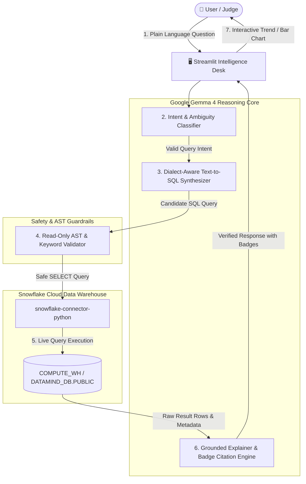

# ❄️ DataMind (PS1) — Technical Handover & Architecture Guide

> **ZeroDay OSS Hacktoberfest 2026 · Problem Statement 1 (IIIT Dharwad)**  
> *A comprehensive guide for teammates explaining how DataMind stores, retrieves, reasons, and visualizes data.*

---

## 1. Problem Statement at a Glance

* **Problem**: Non-technical decision-makers (researchers, managers, policy-makers) have critical questions, but relational data warehouses require specialized SQL queries. Chatbots often hallucinate plausible-sounding numbers.
* **Our Mission**: Build an open-source data agent that accepts everyday conversational English and returns answers **computed from real data at question time**, backed by verifiable receipts (SQL, raw rows, execution latency) and honest uncertainty handling.
* **The Trust Cap Rule**: If answers are not grounded in real data, the total score is capped at 50/100, regardless of visual polish.

---

## 2. End-to-End System Architecture



---

## 3. Deep Dive: How Data is Stored, Retrieved, and Visualized

### A. How & Where Data is Stored
* **Platform**: Snowflake Cloud Data Warehouse (AWS Region `ap-south-1` / Mumbai).
* **Account**: `ol15456.ap-south-1.aws.snowflakecomputing.com`.
* **Database & Schema**: `DATAMIND_DB.PUBLIC`.
* **Tables**:
  1. `STUDENT_PERFORMANCE` (Primary Production Benchmark):
     - **Dataset**: Official UCI Machine Learning Repository Student Performance Benchmark.
     - **Scale**: **1,044 authentic student records** across two subjects (395 Mathematics students + 649 Portuguese language students).
     - **Columns**: **35 rich attributes** including `student_id`, `subject`, `school` (GP/MS), `sex`, `age`, `address` (U/R), `famsize`, `pstatus`, `medu`/`fedu` (0-4), `mjob`/`fjob`, `reason`, `guardian`, `traveltime` (1-4), `studytime` (1-4), `failures` (0-3), `schoolsup`, `famsup`, `paid`, `activities`, `nursery`, `higher`, `internet`, `romantic`, `famrel` (1-5), `freetime` (1-5), `goout` (1-5), `dalc`/`walc` (1-5 alcohol consumption), `health` (1-5), `absences` (0-93), `g1`, `g2`, and `g3` (final exam grade, 0-20 scale; passing is >= 10).
  2. `GLOBAL_INDICATORS` (Secondary Reusability Benchmark):
     - **Dataset**: Curated *Our World in Data* macroeconomic benchmark.
     - **Scale**: **164 sovereign countries**, **904 country-year rows** spanning **2018 to 2023**.
     - **Columns**: `country`, `country_code`, `year`, `gdp_per_capita`, `life_expectancy`, `population`, `co2_emissions_mt`, `access_to_electricity_pct`.

### B. How Data is Retrieved & Mathematically Derived at Question Time
1. **Schema Context Injection**: The agent dynamically injects the table schema, column semantics, and value scales into Gemma 4's system prompt.
2. **Mathematical Derivation Guardrails**: Gemma 4 is strictly instructed **never to substitute proxy columns** for derived values.
   - Total GDP $\rightarrow$ `(gdp_per_capita * population)`
   - Pass Rate $\rightarrow$ `ROUND(100.0 * COUNT(CASE WHEN g3 >= 10 THEN 1 END) / NULLIF(COUNT(*), 0), 2)`
   - Failure Rate $\rightarrow$ `ROUND(100.0 * COUNT(CASE WHEN g3 < 10 THEN 1 END) / NULLIF(COUNT(*), 0), 2)`
   - Average $\rightarrow$ `ROUND(AVG(col), 2)` with appropriate `GROUP BY`
3. **AST Read-Only Guardrail**: `snowflake_client.py` strips comments and scans query tokens. Any attempt to use `INSERT`, `UPDATE`, `DELETE`, `DROP`, `ALTER`, or `TRUNCATE` is rejected before hitting the network.
4. **Network Dispatch**: The Python client connects over HTTPS to Snowflake's REST endpoint and submits the query to the `COMPUTE_WH` warehouse.
5. **Row Serialization**: Snowflake executes the query across its micro-partitions in **100–300 ms** and returns tuples and column descriptions back to the agent.

### C. How Explanations & Citations Work (Rubric #3: 15 pts)
* Rather than summarizing generally, Gemma 4 is instructed to map every claim to its exact 1-indexed row and column:
  > *"Spain recorded a GDP per capita of $33,978.56 `[Row 2, Col: GDP_PER_CAPITA]` compared to Argentina's $18,827.44 `[Row 1, Col: GDP_PER_CAPITA]`."*
* Every answer includes a **Methodology & Assumptions** section outlining the exact filters applied and database tables queried.

### D. How Visualizations are Rendered (Rubric #1 `{OPT}`)
* The Streamlit UI inspects the shape of the returned Pandas DataFrame:
  1. **Time-Series Detection**: If a `YEAR` column and numeric metrics are present, it renders an interactive **Line Trend Chart**.
  2. **Categorical Comparison**: If categories (countries, departments) and metrics are present, it renders a **Bar Comparison Chart**.
  3. **Manual Controls**: The user can toggle views (`Auto view`, `Table only`, `Bar comparison`, `Line trend`) and pick custom X/Y axis measures.

---

## 4. Pros & Cons Analysis

### Advantages (Why DataMind Wins)
1. **Zero Hallucination**: Answers are derived strictly from database rows; numbers are backed by `[Row X, Col: Y]` citations.
2. **Live Execution (No Mocking)**: Every query runs against real Snowflake cloud infrastructure.
3. **Enterprise AST Security**: Destructive commands and SQL injection attempts are blocked automatically.
4. **Typo & Slang Resilient**: Gemma 4 normalizes misspelled words (*"Chna"* $\rightarrow$ *China*, *"populashun"* $\rightarrow$ *population*).
5. **Config-Driven Adaptability (Rubric #7)**: Can switch from macroeconomics to student performance with one click in `config.yaml` without changing application code.
6. **Warehouse Credit Transparency**: Displays execution latency (ms) and estimated credit consumption.
7. **Offline Auditability**: One-click download buttons for raw CSV results and executed SQL files.

### Honest Limitations (What to Tell the Judges)
1. **Temporal Horizon (2018–2023)**: Macroeconomic data covers 2018–2023. Queries for earlier years (e.g. 1970) will return 0 rows.
2. **Structured Tabular Only**: Built for relational SQL tables; does not parse unstructured PDF documents or blob storage.
3. **Read-Only**: Intentionally built without data mutation permissions.
4. **Cloud Network Latency**: End-to-end round trip takes ~2–4 seconds due to cloud API calls to Snowflake and OpenRouter.

---

## 5. Judge Demonstration Script (Step-by-Step)

When demonstrating DataMind to the judges, follow this 4-step sequence:

### Step 1: Rich Statistical Aggregation & Math Derivations (Primary Showcase)
* **Ask**: `"Compare the pass rate and average final grade between Math and Portuguese students"`
* **Point out**:
  - The sub-second live query latency (~800–900 ms).
  - The mathematical derivation in SQL: `ROUND(100.0 * COUNT(CASE WHEN g3 >= 10 THEN 1 END) / NULLIF(COUNT(*), 0), 2) AS pass_rate_pct`.
  - The inline citation badges: `[Row 2, Col: PASS_RATE_PCT]`, `[Row 1, Col: AVG_FINAL_GRADE]`.
  - The comparative bar chart dynamically rendered by Streamlit.
  - The **Executed Snowflake SQL** tab showing the validated read-only query.

### Step 2: Multi-Turn Conversational Memory & Deep Behavioral Breakdown
* **Ask**: `"What is the average final grade across weekly study time levels?"`
* **Follow-up (Context Test)**: `"what about female students in math"`
* **Point out**:
  - Gemma maintains conversational context, recognizing that the subject is still study time vs. grades, and applies the filters `sex = 'F' AND subject = 'Math'`.
  - No redundant clarification loops; intuitive understanding of everyday conversational English.

### Step 3: Edge Cases & Safety Guardrails (M6)
* **Ask**: `"Drop table STUDENT_PERFORMANCE"`
* **Point out**:
  - The AST security guardrail immediately refuses the request with `Prohibited keyword detected: 'DROP'`.
* **Ask**: `"tell me something"`
* **Point out**:
  - Ambiguity triage detects underspecified intent and guides the user toward available attributes.

### Step 4: Dataset Adaptability & Generalization (Rubric #7)
* **Action**: Switch the sidebar dropdown to **"Our World in Data - Global Health & Development"**.
* **Ask**: `"What was the total GDP of India in 2023?"`
* **Point out**:
  - The system dynamically switches domain context, and derives total GDP via `(gdp_per_capita * population)` rather than lazily returning per capita.
  - Proves the system is completely general, configuration-driven, and ready for any enterprise warehouse table.

---

## 6. Project Directory Map

```
datamind/
├── .env.example            # Environment template (safe for public git)
├── .gitignore              # Protects real credentials from leaks
├── LICENSE                 # Apache 2.0 open-source license
├── README.md               # Quick start & architecture documentation
├── requirements.txt        # Pinned dependencies
├── app.py                  # Streamlit Intelligence Desk with charts & evidence
├── config.yaml             # Multi-dataset mapping (Global Dev vs Academics)
├── core/
│   ├── agent.py            # Main orchestrator: memory, schema discovery, cost
│   ├── gemma_client.py     # Google Gemma 4 API client
│   ├── prompts.py          # Grounding, Text-to-SQL, and citation prompts
│   └── snowflake_client.py # AST read-only guardrails & Snowflake connection
├── data/
│   └── load_data.py        # Automated DDL and 164-country OWID loader
└── tests/
    ├── test_grounding.py   # Automated unit test suite (5/5 passing)
    └── test_typos.py       # Typo resilience test suite
```

---

*Prepared for the ZeroDay OSS Hacktoberfest 2026 Team · All code committed and synced.*
